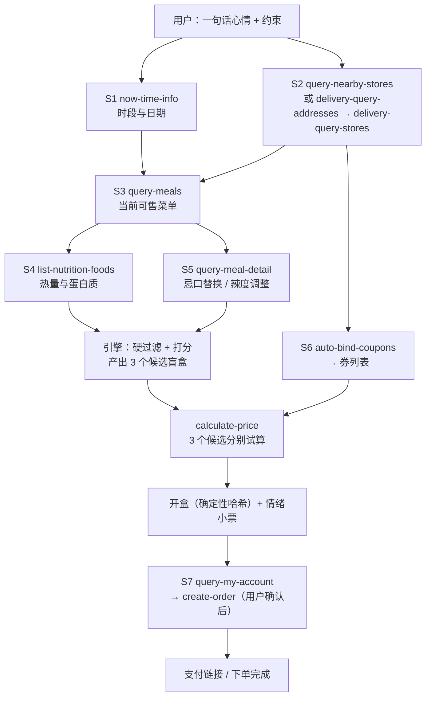

# MCP 集成说明

本文说明「麦麦心情盲盒 · 小票诗」实际使用的麦当劳 MCP Server、Tool、调用流程与业务价值。

## 一、结论速览

| 项目 | 内容 |
|---|---|
| MCP Server | `mcd-mcp`（麦当劳中国官方 MCP 服务） |
| 接入地址 | `https://mcp.mcd.cn` |
| 传输协议 | Streamable HTTP |
| 鉴权 | 请求头 `Authorization: Bearer YOUR_MCP_TOKEN`（Token 由环境变量注入，仓库不含真实凭证） |
| 限流 | 每个 Token 每分钟最多 600 次请求，超限返回 `429`；Token 无效返回 `401` |
| 本项目使用工具数 | 15 个（1 个必用、其余按场景启用） |
| 一次完整体验调用量 | 6-9 次（见第五节） |

### 用到的工具

| Tool | 中文名 | 在本项目中的角色 |
|---|---|---|
| `now-time-info` | 获取当前时间信息 | 判断早餐/正餐时段与日期，参与开盒种子 |
| `query-nearby-stores` | 查询附近可用门店 | 到店场景锚定门店 |
| `delivery-query-addresses` | 获取用户可配送地址列表 | 外送场景取地址 |
| `delivery-query-stores` | 查询可配送的门店列表 | 外送场景锚定门店 |
| `query-meals` | 查询当前可售卖的餐品列表 | **选品的唯一来源**，提供分类与餐品编码 |
| `query-meal-detail` | 查询餐品详情（含套餐组成与可替换项） | 忌口替换、辣度调整、结构确认 |
| `list-nutrition-foods` | 餐品营养信息列表 | 热量与蛋白质目标求解 |
| `campaign-calendar` | 活动日历查询 | 当日活动彩蛋 |
| `auto-bind-coupons` | 麦麦省一键领券 | 下单前自动领券 |
| `available-coupons` | 麦麦省券列表查询 | 可领券清单 |
| `query-my-coupons` | 我的优惠券查询 | 账户可用券 |
| `query-store-coupons` | 当前门店可用优惠券 | 门店可用券 |
| `calculate-price` | 商品价格计算 | **预算硬保证**：3 个候选分别试算到手价 |
| `query-my-account` | 我的积分查询 | 积分提示与激励 |
| `create-order` | 创建订单（返回支付链接） | 用户确认后一键下单 |

可选扩展（当前版本未默认启用）：`mall-points-products` + `mall-create-order`（积分换甜品加料）、`delivery-create-address`（首次外送建地址）。

## 二、接入方式

```json
{
  "mcpServers": {
    "mcd-mcp": {
      "type": "streamablehttp",
      "url": "https://mcp.mcd.cn",
      "headers": { "Authorization": "Bearer ${MCD_MCP_TOKEN}" }
    }
  }
}
```

完整示例见 [`mcp-config.example.json`](./mcp-config.example.json)。Token 申请流程见[麦当劳 MCP 开放平台](https://open.mcd.cn/mcp)。

**关于参数**：麦当劳 MCP 的官方工具清单与用途说明是公开信息；但各工具**具体的请求参数 schema 本仓库无法完整核实**。下文中出现的字段名（如 `storeCode`、`productList`）一律是**按官方工具描述推断的示意参数**，实际调用请以 MCP 返回的 schema 为准。文中给出的调用意图、顺序与依赖关系是实际实现所依赖的部分。

## 三、七步调用主流程

### S1 时间锚定 —— `now-time-info`

- **为什么调**：早餐与正餐的选品池完全不同（早餐时段没有巨无霸，正餐时段没有热香饼）；日期还要参与开盒种子。
- **拿什么**：当前日期、时间、星期。
- **怎么用**：`10:30 前` 判为早餐时段，选品池限定早餐类；日期（`YYYY-MM-DD`）与时段一起进种子，并印在小票上。
- **失败怎么办**：用本机时间兜底，并在小票上标注时间来源。

### S2 门店锚定 —— `query-nearby-stores` 或 `delivery-query-addresses` → `delivery-query-stores`

- **为什么调**：菜单、库存、优惠券、可下单性都与门店绑定；同一心情在不同门店本就该开出不同的盒。
- **拿什么**：门店编码、门店名称、营业状态。（外送场景还含配送地址与预估送达）
- **怎么用**：门店编码作为 `seedExtra` 参与开盒种子；门店名称印在小票抬头。
- **失败怎么办**：跳过 S7，只出小票，并明确告知用户「没找到门店，先给你小票」。

### S3 拉取真实菜单 —— `query-meals`

- **为什么调**：盲盒里的每一件都必须是这家店此刻真的在卖的东西。这是整个项目「不编造」的地基。
- **拿什么**：餐品分类、餐品名称、餐品编码、标签、供应时段。
- **怎么用**：按分类归入四个池子（主食 / 配餐 / 饮品 / 甜品），后续所有组合只能从这四个池子里取。
- **失败怎么办**：进入演示模式（仓库内置演示菜单），并在小票上标注「演示数据，价格与热量仅供参考」。

### S4 营养约束 —— `list-nutrition-foods`

- **为什么调**：「减肥」「通宵」「加班」这些情绪的目标是热量与蛋白质，没有营养数据就只能拍脑袋。
- **拿什么**：能量、蛋白质（以及脂肪、碳水、钠、钙）。
- **怎么用**：算出每个候选盲盒的人均热量与人均蛋白，与情绪档案的目标值比对；用户设了人均热量上限时作为硬过滤。
- **失败怎么办**：按品类估算区间，并在小票标注「估算值」。

### S5 结构与忌口替换 —— `query-meal-detail`

- **为什么调**：用户说「不要牛肉」「不要冰的」「不太辣」，需要知道一份套餐里有什么、能不能换。
- **拿什么**：套餐组成、可选替换项、餐品特制选项。
- **怎么用**：命中忌口的餐品优先替换，换不掉就整件剔除；「不辣」优先替换为不辣版本。
- **失败怎么办**：保守处理——无法确认成分的餐品直接排除，宁可少一个选择，也不踩用户的忌口。

### S6 领券并试算价格 —— `auto-bind-coupons` → `available-coupons` / `query-my-coupons` / `query-store-coupons` → `calculate-price`

- **为什么调**：用户给的预算是硬条件，「不超预算」必须算出来；同时把用户平时想不起来用的券自动叠加掉。
- **拿什么**：可领券列表、账户可用券、门店可用券；每套候选组合的金额明细（商品金额、配送费、优惠金额、应付总价）。
- **怎么用**：先一键领券 → 再对 3 个候选盲盒分别试算到手价 → **超预算的候选直接淘汰** → 用「结余」写进小票。
- **失败怎么办**：用参考价并在小票标注；全部候选都超预算时，用最低价组合反推最低预算并告知用户。

### S7 下单转化 —— `query-my-account` → `create-order`（可选：`campaign-calendar`、`mall-points-products` + `mall-create-order`）

- **为什么调**：小票是入口，下单才是闭环；积分与当日活动是自然的下单动机。
- **拿什么**：可用积分、当日活动、订单号与支付链接。
- **怎么用**：先告诉用户「这单能得多少积分」→ **用户明确同意后**再创建订单，把支付链接交给用户；当日活动命中时在盲盒里加一个「今日活动彩蛋」。
- **失败怎么办**：下单失败不影响小票，把失败原因如实告诉用户并提供重试。

> **未经用户确认不得创建订单。** 这是不可逆的外部动作。

## 四、调用顺序与依赖



**可以并行的部分**：S1 与 S2 无依赖，可同时发起；`available-coupons`、`query-my-coupons`、`query-store-coupons` 三者互不依赖，可在 `auto-bind-coupons` 之后并发查询；`campaign-calendar` 与 `query-my-account` 全程可并发。

**强依赖（必须串行）**：`query-meals` 依赖 S2 的门店编码 → `calculate-price` 依赖 S3 的餐品编码与 S6 的券 → `create-order` 依赖 `calculate-price` 的结果与用户确认。

**为什么「打分」这一步不放在 MCP 里**：MCP 负责事实（有什么、多少钱、多少热量），引擎负责偏好（该选什么）。把偏好计算留在本地，才能保证同样的输入永远得到同样的输出、并且可以离线自检。

## 五、调用预算

| 步骤 | 工具 | 一次体验的调用次数 |
|---|---|---|
| S1 | `now-time-info` | 1 |
| S2 | `query-nearby-stores`（到店）或 `delivery-query-addresses` + `delivery-query-stores`（外送） | 1 / 2 |
| S3 | `query-meals` | 1 |
| S4 | `list-nutrition-foods` | 1 |
| S5 | `query-meal-detail`（只对最终入盒的餐品调用） | 1-3 |
| S6 | `auto-bind-coupons` + 券查询（并发 1-3 次）+ `calculate-price` × 3 | 5 |
| S7 | `query-my-account` + `create-order`（用户确认后） | 1-2 |
| **合计** | | **6-9 次**（不含可选的活动与商城工具） |

按官方限流 600 次/分钟计算，一次完整体验只占用约 **1.5%** 的额度；即使 40 个用户在同一分钟内同时使用，也不会触发 `429`。设计上刻意做了三件事压低调用量：营养数据一次拉取本地复用、`query-meal-detail` 只查最终入盒的少数餐品、券查询并发而非串行。

## 六、降级与容错矩阵

| 情况 | 系统表现 | 用户看到的话 |
|---|---|---|
| `401` Token 无效或过期 | 停止调用 MCP，切换演示菜单，小票标注「演示数据」 | 「MCP Token 好像失效了。我先用演示菜单给你开一盒，配上 Token 后价格就是真实的。」 |
| `429` 触发限流 | 指数退避重试 1 次；仍失败则复用本次已取到的数据继续 | 「刚才请求有点密，我用已经拿到的数据继续，不会让你重复输入。」 |
| 门店列表为空 | 跳过 S7，仅出小票 | 「没找到能下单的门店，先把小票给你。告诉我门店名我再帮你下单。」 |
| 营养数据缺字段 | 按品类估算区间，小票标注「估算值」 | 「这份热量是估算的，以门店实际为准。」 |
| `calculate-price` 失败 | 退化为参考价，小票标注 | 「这单价格我暂时算不准，先按参考价给你看。」 |
| 所有候选都超预算 | 反推最低价组合 | 「这个预算装不下任何一盒，最低 17.50 元起（吉士汉堡 + 矿泉水），要按最低价配吗？」 |
| 用户中途改约束 | 重新生成三盒并重新开盒（种子变了） | 「约束变了，种子也跟着变，所以这一盒是新的。」 |
| 用户拒绝下单 | 保留小票，不创建订单 | 「好的，小票给你留着，想点了随时说一声。」 |

## 七、业务价值

### 用户价值

| 价值 | 口径 |
|---|---|
| 把选择时间从分钟级压到一次输入 | 常规点餐要在几十个 SKU 里翻找、比价、算热量（约 5-8 分钟）；这里只需一句心情 + 一次确认 |
| 预算不再靠猜 | 3 个候选都经 `calculate-price` 试算，到手价、结余、省下的钱直接印在小票上 |
| 券不再被忘记 | `auto-bind-coupons` 在下单前自动领券并叠加，把「想不起来用」变成默认动作 |
| 忌口与控卡有硬保证 | 忌口成分直接出局，热量上限是硬约束，而不是「尽量」 |
| 情绪被认真对待 | 小票上的推荐理由直接呼应用户自己那句话，并提供一张可保存、可朗读的情绪小票 |
| 结果可复现、可分享 | 同一天同一心情开出同一盒，用户可以核对、可以转发，不制造焦虑 |

### 麦当劳价值

| 价值 | 口径 |
|---|---|
| 提升客单价与结构完整度 | 组合化推荐（主食 + 配餐 + 饮品 + 甜品）天然比单品点餐更完整；每盒还会在剩余预算内给出一次加购建议 |
| 提升优惠券核销 | 把领券动作前置到「下单前」，从用户主动想起变成系统默认叠加 |
| 拉新与自然传播 | 情绪小票是**可分享资产**：一张带取餐码与诗句的长图，天然适合社交平台传播，且每张小票都是个性化的 |
| 拉高会员活跃 | 积分提示（`query-my-account`）把「这单能得多少分」放到决策现场 |
| 全时段覆盖 | 早餐时段、正餐时段、到店、外送四条路径都被同一套流程覆盖 |
| 零成本冷启动 | 引擎无第三方依赖，网页 Demo 离线可跑，部署成本接近零 |

## 八、声明

- 本项目**真实调用**麦当劳 MCP 服务（`https://mcp.mcd.cn`），调用逻辑见上述七步流程与本仓库 `SKILL.md`。
- 仓库内**不含任何真实 Token、手机号、地址或支付信息**；`mcp-config.example.json` 仅使用环境变量占位符，`.gitignore` 已排除 `.env` 与 `*.token`。
- 演示菜单（`engine/menu.demo.js`）仅用于无 Token 时的离线兜底，所有输出都标注了「演示数据」。
- 本项目为参赛作品，非麦当劳官方产品；餐品、价格与供应状态以麦当劳官方渠道实时结果为准。
