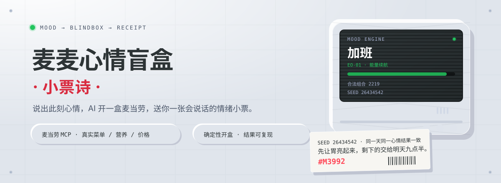
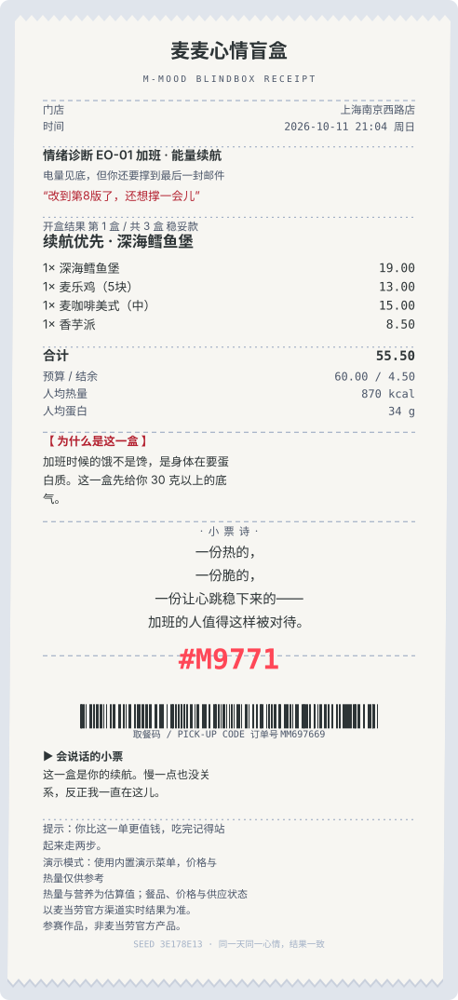
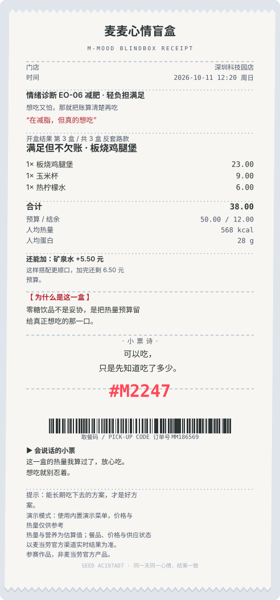

<p align="center">
  
</p>

<p align="center">
  <b>说出此刻心情，AI 开一个麦当劳盲盒套餐，并送你一张会说话的情绪小票。</b>
</p>

<p align="center">
  <code>麦当劳 MCP 真实菜单</code> · <code>约束先算清再开盒</code> · <code>结果可复现</code> · <code>离线也能跑</code>
</p>

---

## 这是什么

加班到第 8 版、刚被老板说了一顿、在减脂又真的想吃、赶时间只剩五分钟、今天顺得想庆祝一下——
这些时刻的共同点是：**你知道自己什么心情，但不知道吃什么**。

麦麦心情盲盒做一件事：**把「心情 + 预算 + 忌口 + 热量」翻译成一份算得清、拿得走、说得出口的餐**。

1. 你说一句心情（或点一个心情标签）；
2. 补几个约束：预算、人数、辣度、忌口、人均热量上限；
3. 它调麦当劳 MCP 拿**当前门店真实可售菜单与营养数据**，生成 3 个盲盒套餐；
4. 开盒揭晓其中 1 个（结果由「日期 + 心情 + 约束」的哈希决定，同一天同一心情永远是同一盒）；
5. 给你一张 **情绪小票**：套餐明细、推荐理由、3-5 行小票诗、取餐码、语音祝福——可以保存成长图分享，也可以直接下单。

### 三个不妥协的地方

| 原则 | 具体做法 |
|---|---|
| 先算账，再开盒 | 预算、忌口、辣度、热量上限都是**硬过滤 + 硬校验**，不会出现「开出来超预算」。预算装不下时会直接告诉你最低需要多少钱。 |
| 盲盒不是抽奖 | 开盒结果由确定性哈希决定，**可复现、可核对、可分享**。没有概率、没有抽卡、没有诱导重复消费。 |
| 拿不到实时数据也不撒谎 | 没有 MCP Token 时进入演示模式，在小票和界面上明确标注「演示数据」，不假装是真价。 |

---

## 效果：会说话的情绪小票

<p align="center">
  
  
</p>

小票上有四样东西是别处拿不到的：

- **情绪诊断**：把你的一句话归到一个情绪档案（`EO-01 加班 · 能量续航`），这套档案决定了后面所有的取舍。
- **为什么是这一盒**：不是「推荐理由」，而是**为什么在你这句心情下选了这几样**。
- **小票诗**：3-5 行，短、轻、不说教。十一种心情各 6 首，按种子轮换。
- **语音祝福 + 取餐码**：小票会读出来，取餐码由种子生成，跟今天的这一盒绑定。

### 界面：一台真的机器

Demo 用的是 **Industrial Skeuomorphism（工业拟物 / 机械现实主义）** 设计语言：冷调哑光底盘、左上 45° 恒定光源、双侧光源阴影、机身四角螺丝与散热槽、LED 状态灯、CRT 屏幕扫描线、工序之间的物理管道。安全橙只出现在需要被按下的地方。

互动也遵守物理规律：**机盖滑开 → LED 点亮 → 小票从托盘里吐出来**，而不是淡入淡出。所有色值、阴影、圆角、动效都集中在 `web/style.css` 的 `:root` 里，没有散落的一次性样式；小票 SVG 复用同一套调色板。

有一处刻意的偏离：设计系统原本规定「安全橙 `#ff4757` + 白字」，实测对比度只有 3.34:1，13px 按钮文字达不到 WCAG AA。因此把橙色拆成三档——`#ff4757` 继续做品牌识别（LED / 辉光 / 描边），填充面用 `#d92b3f`（白字 4.81:1 ✅），底盘上的小字强调用 `#a8232f`（5.63:1 ✅）。细节与实测数据见 [`docs/design-system.md`](./docs/design-system.md)。

---

## 30 秒上手

### 方式一：直接开网页（不需要 Token，不需要装任何东西）

**在线体验 → [hellolinli.github.io/maimai-mood-blindbox](https://hellolinli.github.io/maimai-mood-blindbox/)**　点开就能玩，用内置演示菜单离线运行。

想在本地跑：

```bash
git clone https://github.com/helloLinli/maimai-mood-blindbox.git
cd maimai-mood-blindbox
# 双击 web/index.html 即可
```

也可以用深链直接分享某个心情的盲盒（打开就自动开盒）：

```text
https://hellolinli.github.io/maimai-mood-blindbox/web/index.html?mood=overtime&budget=60&people=1
```

（根地址 `https://hellolinli.github.io/maimai-mood-blindbox/?mood=overtime&budget=60&people=1` 会保留参数跳转到上面这一页，两种写法都能用。）

### 方式二：作为 Skill 接进 Agent（WorkBuddy / Cherry Studio / Cursor / Trae）

1. 到 [麦当劳 MCP 开放平台](https://open.mcd.cn/mcp) 申请 MCP Token；
2. 按 [`mcp-config.example.json`](./mcp-config.example.json) 配置 MCP Server（把 `${MCD_MCP_TOKEN}` 换成你的 Token）；
3. 把 [`SKILL.md`](./SKILL.md) 交给 Agent，并把 `references/` 目录一起给它；
4. 直接说：**「加班到第 8 版，预算 60，忌口牛肉，帮我开一个盲盒」**。

### 方式三：命令行跑一次

```bash
node engine/cli.js box     --mood 加班 --budget 60 --people 2 --avoid beef --spicy 1
node engine/cli.js receipt --mood 失恋 --budget 45 --utterance "分了，心里空空的"
node engine/cli.js receipt --mood 庆祝 --budget 120 --people 2 --format svg --out receipt.svg
node engine/cli.js selfcheck     # 58 项断言：预算 / 忌口 / 辣度 / 热量 / 可复现性
node engine/cli.js layoutcheck   # 小票版式：溢出与压字检查
```

零第三方依赖（Node ≥ 18 即可）。

---

## 使用示例

下面三段都是**真实输出**，命令里带 `--date` 是为了固定开盒种子，你照着跑会得到一模一样的结果。

**① 加班到第 8 版（预算 60 / 1 人 / 忌口牛肉）**

```bash
node engine/cli.js receipt --mood overtime --budget 60 --avoid beef --date 2026-10-11T21:04:00 --format text
```

```text
情绪诊断  EO-01  加班 · 能量续航
开盒结果  第 1 盒 / 共 3 盒 · 稳妥款
套餐  续航优先 · 深海鳕鱼堡
  1× 深海鳕鱼堡       19.00
  1× 麦乐鸡（5块）    13.00
  1× 麦咖啡美式（中） 15.00
  1× 香芋派            8.50
合计 55.50 元 / 结余 4.50 元 / 人均 870 kcal · 蛋白 34 g
```

「加班」的目标是 880 kcal / 34 g 蛋白，被算中了；忌口牛肉全程没有出现。小票诗是「咖啡因负责点亮 / 蛋白质负责撑住 / 剩下那点甜 / 负责让你记得自己不是机器」。

**② 在减脂但真的想吃（预算 50 / 人均热量 ≤600）**

```bash
node engine/cli.js receipt --mood fit --budget 50 --kcal 600 --date 2026-10-11T12:20:00 --format text
```

```text
开盒结果  第 2 盒 / 共 3 盒 · 惊喜款
合计 37.50 元 / 人均 560 kcal · 蛋白 28 g   ← 正好卡在 600 kcal 上限内
还能加：苹果片  +6.00 元
```

零糖饮品与蔬菜类被排到前面，热量预算留给主食。因为这一盒偏轻，小票会主动给一条加购建议（加完还剩 6.50 元预算）。

**③ 庆祝（预算 120 / 2 人）**

```bash
node engine/cli.js receipt --mood celebrate --budget 120 --people 2 --date 2026-10-11T19:10:00 --format text
```

```text
开盒结果  第 3 盒 / 共 3 盒 · 反套路款
套餐  两个人也够 · 巨无霸（双份牛肉）
  2 份主食 + 2 份配餐 + 2 杯饮品 + 2 份甜品 = 8 件
合计 118.50 元 / 结余 1.50 元 / 人均 1255 kcal · 蛋白 47 g
```

结构随人数自动放大成「双主食 + 双配餐 + 双饮品 + 双甜品」，总额被压在预算内。预算或忌口装不下时，会**降级并在小票上写明省掉了什么**，而不是偷偷换便宜货。

---

## 它是怎么算出来的

```text
一句话心情 ──► 情绪档案（结构 / 热量目标 / 蛋白目标 / 预算比例 / 语气）
                  │
预算·人数·辣度·忌口·热量 ──► 硬过滤 ──► 组合枚举 ──► 加权打分 ──► 三盒
                  │                                     │
                  └────── 确定性哈希 ──► 开盒 ──► 情绪小票 ──► 长图 / 语音 / 下单
```

**第一步，硬过滤（先淘汰，不参与打分）**：时段（早餐 / 正餐）、忌口成分、辣度上限、情绪硬规则（例如「赶时间」的每一件都必须单手可食）。

**第二步，组合打分（同一口径，可以手算）**：

| 打分项 | 权重 | 说明 |
|---|---|---|
| 标签契合 | 累加 | 每件餐品的标签按情绪权重加减分（「加班」对 `高蛋白 +1.5`、`含咖啡因 +1.3`） |
| DNA 命中 | 每件 0.9 / 每盒 0.8 | 情绪档案里「必须尽量命中的标签」 |
| 热量贴近 | 最高 2.0 | 与每人目标热量的偏离，超出容差即归零 |
| 蛋白质达标 | 最高 1.6 | 每人蛋白质 ÷ 目标蛋白质，封顶 1 |
| 预算贴近 | 最高 2.2 | 期望花掉预算的 70%-95%；超预算直接淘汰 |
| 结构完整 | ±1.5 | 该给甜品却没给则扣分 |

**第三步，三盒产出**：稳妥款取最高分；惊喜款要换掉主食且至少换两个位置；反套路款把主食、配餐、饮品三个位置全换。同分按餐品编码字典序打破平局，**保证任何机器上跑出来的结果完全一致**。

完整规则、情绪档案数值与「怎么加一个新情绪」见 [`references/emotion-matrix.md`](./references/emotion-matrix.md)。

---

## 麦当劳 MCP 集成

本项目**真实调用**麦当劳 MCP（`https://mcp.mcd.cn`，Streamable HTTP）。一次完整体验约 6-9 次调用：

| 步骤 | 工具 | 用途 |
|---|---|---|
| S1 | `now-time-info` | 判断早餐 / 正餐时段与日期（决定选品池、小票时间戳、开盒种子） |
| S2 | `query-nearby-stores` / `delivery-query-stores` | 锚定门店或配送范围 |
| S3 | `query-meals` | 当前门店真实可售菜单，作为选品的唯一来源 |
| S4 | `list-nutrition-foods` | 热量与蛋白质，支撑「减脂」「通宵」等目标求解 |
| S5 | `query-meal-detail` | 套餐组成与可替换项，用于忌口替换与辣度调整 |
| S6 | `auto-bind-coupons` → `available-coupons` / `query-my-coupons` / `query-store-coupons` → `calculate-price` | 先领券再算价，「不超预算」是算出来的 |
| S7 | `query-my-account` → `create-order` | 积分提示与一键下单；`campaign-calendar` 用来塞今日活动彩蛋 |

调用顺序、并行关系、调用次数预算与降级矩阵见 [`MCP_INTEGRATION.md`](./MCP_INTEGRATION.md)。

---

## 目标用户

| 人群 | 他们的原话 | 这个项目解决什么 |
|---|---|---|
| 决策疲劳的上班族 | 「随便，都行」 | 午休十分钟内出结果，不用刷菜单 |
| 情绪化进食的年轻人（18-30） | 「今天必须吃点好的」 | 先把情绪翻译成结构，再决定吃什么 |
| 控卡人群 | 「想吃又怕胖」 | 热量先算清，蛋白质优先，零糖替代 |
| 赶时间的通勤族 | 「五分钟就要出门」 | 全部单手可食、饮品能盖紧 |
| 精打细算的麦门人 | 「券又忘了用」 | 下单前自动领券并试算到手价 |
| 帮同事带饭的人 | 「帮 4 个人点」 | 按人数放大份数并控制总额 |

---

## 项目结构

```text
maimai-mood-blindbox/
├── README.md                  本文件
├── SKILL.md                   Skill 主入口：Agent 按它执行整套流程
├── MCP_INTEGRATION.md         参赛要求：MCP Server / Tool / 调用流程 / 业务价值
├── mcp-config.example.json    脱敏配置示例（仅环境变量占位符）
├── CONTEST_DECLARATION.md     参赛声明（官方原文，未做任何改动）
├── workbuddy.md               WorkBuddy 联动说明
├── engine/                    决策引擎（Node 与浏览器共用同一份实现）
│   ├── content.js             情绪档案 + 小票诗库 + 语音祝福
│   ├── menu.demo.js           演示菜单（离线兜底：标签/成分/辣度/热量/价格）
│   ├── blindbox.js            约束求解 + 打分 + 三盒产出 + 确定性开盒
│   ├── receipt.js             小票渲染（SVG 长图 / 纯文本）+ 版式自检
│   └── cli.js                 命令行入口 + 自检
├── index.html                 GitHub Pages 入口（跳转到 web/，页面只有一份实现）
├── web/                       交互 Demo（双击即可运行，无需服务器）
├── references/                情绪矩阵、诗词手册、MCP 调用配方
├── examples/                  完整体验记录（含真实生成的小票）
├── assets/                    小票样张与横幅
└── docs/design-system.md      设计系统落地说明、token 表与无障碍取舍
```

---

## 质量保证

```text
$ npm test
自检结果：通过 58 项，失败 0 项，随机验证 450 盒
版式自检：检查 528 张小票，发现问题 0 处
```

- **约束自检**：200 组随机约束（预算 12-212 元、1-4 人、随机忌口 / 辣度 / 热量上限）共 450 盒，逐一断言不超预算、不碰忌口、不越辣度、不超热量。
- **可复现性自检**：同参数两次生成必须完全一致；换一天必须换种子。
- **版式自检**：11 种情绪 × 5 档预算 × 4 种输入长度的 528 张小票，检查文字溢出与同一行压字。
- **浏览器自检**：Demo 页面加载时自动跑一遍关键断言，不通过会在控制台报错。

---

## 合规与边界

- 本项目为**参赛作品，非麦当劳官方产品**，不代表也不暗示任何官方背书。
- 不评价体型、不鼓吹节食、不承诺减重效果；「减脂」场景的落点是**把热量算清楚再吃**。
- 盲盒是**决策包装，不是抽奖**：没有概率、没有付费、没有诱导重复消费。
- 不使用烟酒、赌博、迷信、拜金等元素，不与其他品牌做对比。
- 热量与营养为估算值；餐品、价格与供应状态**以麦当劳官方渠道实时结果为准**。
- 仓库内**不含任何真实 Token、手机号、地址等个人信息**，配置仅使用环境变量占位符。

---

## 常见问题

**没有 MCP Token 能跑吗？**
能。`engine/menu.demo.js` 是离线演示菜单，网页 Demo 与 CLI 都会自动降级，并在小票上标注「演示模式」。

**为什么开盒结果每次都一样？**
因为结果由「日期 + 心情 + 约束」的哈希决定。这是刻意的：可复现才可分享、可核对，也避免把吃饭变成抽卡。想换结果就改心情、改约束，或者换一天。

**换一家店结果会一样吗？**
不会。门店号作为额外种子参与计算（`seedExtra`），同一心情在不同门店可以开出不同的盒。

**能不能加菜？**
能。每一盒都会在剩余预算内算出「还能加一份什么」，并说明理由（补蛋白 / 补热量 / 加一点甜的收尾）。

---

<p align="center">
  <sub>参赛作品 · 非麦当劳官方产品 · 请阅读 <a href="./CONTEST_DECLARATION.md">CONTEST_DECLARATION.md</a></sub>
</p>
